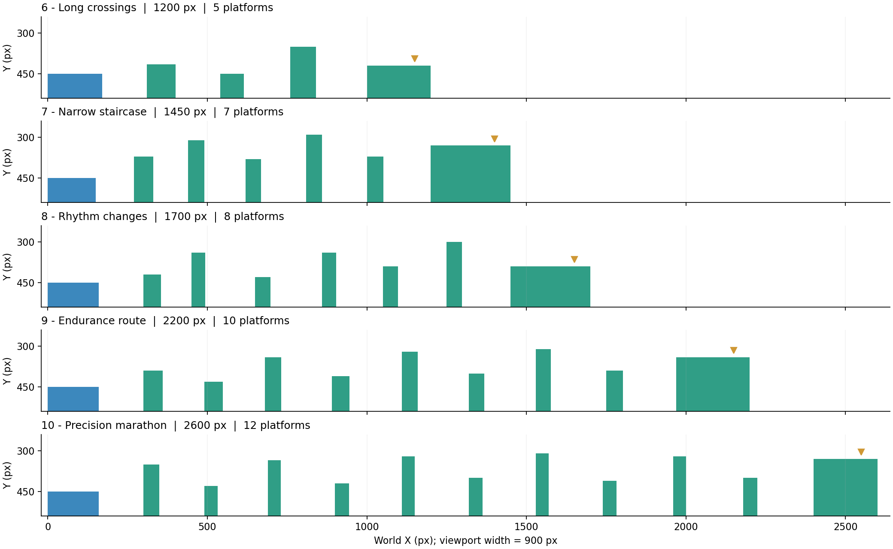
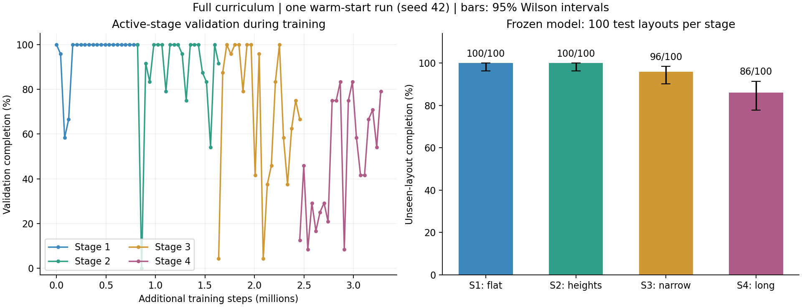

# Fulll_version.docx：新增關卡與訓練紀錄

本次依 [完整版研究提案](Fulll_version.docx) 的平台距離、寬度、高低差、平台數與操作精度擴充關卡。新增第 6～10 關與第四階段隨機長路線，並完成固定關卡及單一隨機關卡代理的 PPO 訓練。

## 文件與實作對照

| 提案內容 | 本次實作 |
| --- | --- |
| Stage 1：簡單平台 | 寬平台、相同高度，保留原生成規則 |
| Stage 2：不同高度 | 中等平台與可變高度 |
| Stage 3：長跳距與小平台 | 固定第 5～8 關與第三階段隨機窄落點 |
| Stage 4：多平台連續決策 | 第 9～10 關，以及隨機 8～12 平台的長路線 |
| Stage 5：未見關卡 | 凍結單一模型後，對四種地形各測試 100 張保留地圖 |
| PPO、低維狀態、離散動作 | 沿用 NumPy actor-critic PPO、GAE、六個移動／跳躍動作 |
| 塑形獎勵與檢查點 | 沿用有號水平位移與首次平台獎勵；中點 +5 是一次性獎勵，沒有復活功能 |
| 模型保存與評估 | 每階段 checkpoint、驗證曲線、地圖 seed／雜湊、逐回合 CSV、隨機策略基準 |

採用提案允許的固定步數預算，沒有實作「達到通關門檻才升級」的自動排程。CNN 視覺輸入是提案的選做延伸，本次使用數值狀態。物理維持靜態、單向落地平台、慣性與空中控制。

## 新固定關卡

| 關卡 | 名稱 | 平台數 | 世界寬度 | 最窄中繼平台 | 步數上限 |
| --- | --- | ---: | ---: | ---: | ---: |
| 6 | Long crossings | 5 | 1,200 | 75 | 560 |
| 7 | Narrow staircase | 7 | 1,450 | 48 | 700 |
| 8 | Rhythm changes | 8 | 1,700 | 44 | 800 |
| 9 | Endurance route | 10 | 2,200 | 46 | 980 |
| 10 | Precision marathon | 12 | 2,600 | 40 | 1,200 |

單位為像素／模擬步數。畫面維持 900×540，鏡頭跟隨角色並限制於世界邊界；上方縮圖呈現整條路線。按鍵 1～9 選關、0 選第 10 關。



使用 `models/level5_policy.json` 接續訓練第 6～10 關，下一關載入上一關的最佳 checkpoint。各關 300 次更新、8 個環境、每環境 256 步，learning rate 0.0003、entropy 0.02，35% 訓練回合由中途平台開始。每關新增 614,400 步，五關共 3,072,000 步；不含舊第 5 關的訓練成本。

每 20 次更新，以 seed 912 產生的 24 個起點選模；最後使用獨立 seed 100912 的 100 個起點測試。起點均在第一個平台的 X=25～50。各關的訓練 seed 為 47～51，沿用 17 維舊模型架構。

| 關卡 | 選中 update | PPO 通關 | 隨機策略 | 平均步數 | 預設 X=35 通關 |
| --- | ---: | ---: | ---: | ---: | --- |
| 6 | 220 | 100/100 | 0/100 | 212.18 | 是 |
| 7 | 240 | 100/100 | 0/100 | 304.95 | 是 |
| 8 | 180 | 100/100 | 0/100 | 341.13 | 是 |
| 9 | 0 | 100/100 | 0/100 | 440.97 | 是 |
| 10 | 20 | 100/100 | 0/100 | 535.11 | 是 |

第 9 關的接續初始模型已達到最佳驗證表現，因此保留 update 0，沒有強制選擇較晚的模型。訓練曲線中偶有退步，展示使用驗證集選中的 checkpoint。各關是獨立模型，這個表不代表同一個模型解完所有關卡，也不代表未見地圖的泛化率。

## 完整版單一模型

`full_curriculum.py` 的生成器版本為 `full-v1`。第 1～3 階段沿用既有幾何規則，第 4 階段每張地圖包含 8～12 個平台，中繼平台寬 40～80 px、間隙 100～170 px，每次高度變化限制為上升至多 100 px、下降至多 90 px，平台 Y 位於 270～450。終點平台寬 200 px；世界寬度隨路線計算，時間上限為 `200 + 平台數 × 80`。

資料切分使用 `split_offset + stage × 100000 + index`，train／validation／test offset 為 3000000／4000000／5000000。每階段有 1,000 張訓練地圖、24 張驗證地圖及 100 張測試地圖；測試起點也是固定 seed 生成的 X=25～50。執行前檢查三個切分的幾何雜湊沒有重複，並檢查本次驗證／測試地形未與專案既有固定地圖及舊隨機資料切分重複。

本次設定：

- 從 `experiments/easy_pdf/ppo_shaped/policy.json` 接續；該模型原來的訓練 seed 為 43，輸入 18 維。
- 本次訓練 seed 為 42，每階段 400 次更新，8×256 步／次，共新增 3,276,800 步。初始模型副本及 SHA-256 已保存；以上步數不包含舊模型訓練。
- learning rate 0.0003、entropy 0.02、25% 回合複習舊階段、25% 機率由中途平台開始；沒有示範軌跡或手寫控制器。
- 每 20 次更新評估；按已學階段的平均驗證通關率、平台覆蓋率、進度、速度依序選模。
- 階段 1～4 選中 update 分別為 0、380、300、180。保留較早階段表現也是選模條件，因此第四階段最高單項通關率的 checkpoint 不一定被選中。
- 四階段完成後凍結權重，才進行文件 Stage 5 的測試；測試與驗證全部從第一個平台開始。

### 未見地圖測試

| 地形 | 通關 | 死亡 | 超時 | 平均進度 | 成功回合平均步數 |
| --- | ---: | ---: | ---: | ---: | ---: |
| Stage 1 | 100/100 | 0 | 0 | 100% | 144.81 |
| Stage 2 | 100/100 | 0 | 0 | 100% | 162.27 |
| Stage 3 | 96/100 | 4 | 0 | 99.1% | 200.00 |
| Stage 4 | 86/100 | 14 | 0 | 95.8% | 449.33 |

隨機策略在相同四組地圖／起點皆為 0/100。第四階段 95% Wilson 區間為 77.9%～91.5%，描述此單一模型在地圖取樣上的不確定性，沒有衡量不同訓練 seeds 的變異。原 `easy.pdf` 九組對照結果完整保留，不能用不同預算及切分下的本次結果直接宣稱演算法優於舊版。



仍有 14 張長路線測試地圖失敗，例如 seed 5400004 的最大水平進度約 35.7%、seed 5400032 約 22.9%。其他失敗包含接近終點才掉落的回合。逐回合結果完整保留於 `test_episodes.csv`，沒有刪除失敗地圖或重新訓練後再挑測試成績。幾何檢查只排除明顯超出單跳距離的布局，不是完整可達性證明。

## 播放與重現

在專案根目錄執行：

```powershell
# 已訓練的固定第 10 關。
python game.py --agent --level 10 --trace

# 同一個完整版模型可遊玩四個隨機階段。
python game.py --agent --full-curriculum --stage 4 --trace

# 重現訓練，寫入新的資料夾。
python train_full.py --init-policy experiments/easy_pdf/ppo_shaped/policy.json --updates-per-stage 400 --output-dir experiments/my_full_run

# 僅重測附帶模型，不更新權重。
python train_full.py --evaluate-only

# 匯出長路線展示。
python game.py --agent --level 10 --trace --headless --screenshot artifacts/level10.png --trajectory artifacts/level10_trajectory.json

# 重新繪圖及執行測試。
python plot_full.py
python -m unittest discover -v
```

`experiments/full_version/` 包含 `initial_policy.json`、四個階段 checkpoint、最終 `policy.json`、`manifest.json`、`results.json`、`learning_curve.csv`、`test_episodes.csv` 與圖表。`models/` 包含各固定關卡模型與報告。遊戲預設 X=35，評估 CSV 使用其記錄的隨機起點；只指定相同地圖 seed 不代表完全相同的測試回合。

驗證結果：26 個自動測試通過；第 10 關與第四階段首張測試地圖的無視窗展示均通關；`train_full.py --evaluate-only` 重跑 400 個回合後，回報 `matches_saved_results: true`。
