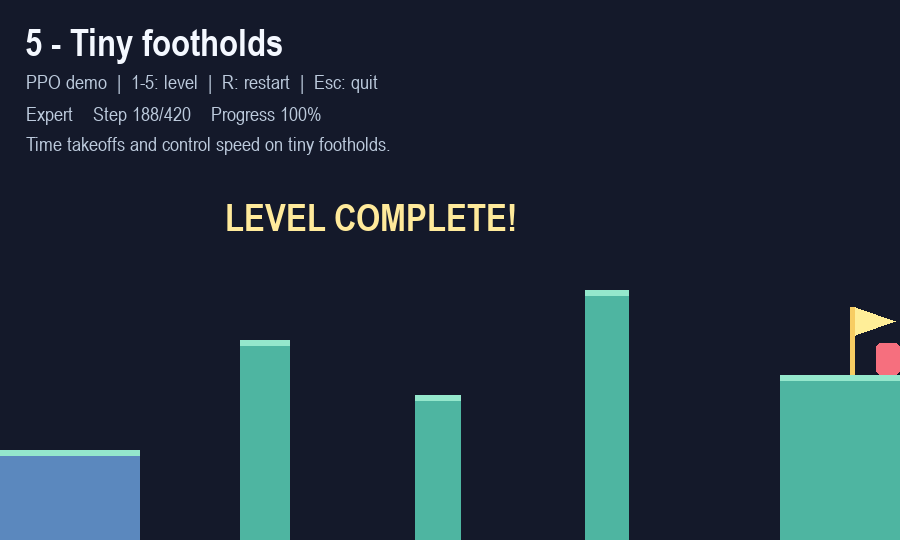

# Precision Platformer：固定／隨機關卡與 PPO 強化學習

使用相同的物理環境供玩家與 RL 代理遊玩。五個固定關卡由寬平台逐步增加高低差、縮小落點，再加入長距離跳躍。已附上實際訓練好的模型，可以直接觀看每一關的通關過程。

## 依 easy.pdf 新增的研究功能

依照 [easy.pdf](easy.pdf) 的 §2.3、§2.5、§2.6 與 §3，新增三階段隨機地圖、單一模型的課程學習、自動跳躍 PPO、稀疏獎勵 PPO，以及未見地圖的評估。原本五關與模型仍可遊玩。

在專案目錄觀看新模型：

```powershell
python game.py --agent --procedural --stage 3 --trace
```

隨機模式下，**1～3** 切換階段、**N** 換地圖、**R** 重試相同地圖、**T** 顯示／隱藏軌跡。預設模型由驗證集選出，來自 seed 43；它在三階段各 100 張未見地圖的測試通關數為 **100、100、96**。

這是展示模型的結果。完整比較包含三個訓練 seeds（42、43、44），每個模型以每階段 100 張相同的未見地圖測試，合計 9 組訓練、2,700 回合。以下為跨訓練 seeds 的平均通關率 ± 樣本標準差：

| 方法 | 階段 1：寬平地 | 階段 2：高低差 | 階段 3：窄落點 |
| --- | ---: | ---: | ---: |
| PPO＋塑形獎勵 | 67.3% ± 28.3% | 96.3% ± 6.4% | 78.7% ± 25.8% |
| 自動跳躍 PPO＋塑形獎勵 | 51.0% ± 0.0% | 96.3% ± 6.4% | 85.0% ± 26.0% |
| PPO＋稀疏獎勵 | 33.3% ± 57.7% | 30.0% ± 51.1% | 15.0% ± 26.0% |

塑形獎勵在這次預算下的平均通關率較高；自動跳躍在窄平台也能表現良好，尚不能宣稱手動跳躍一定優於自動跳躍。不同訓練 seeds 的差異仍很大。泛化測試限於目前生成器的地形範圍。


完整設計對照、參數、重現指令與限制見 [EXPERIMENTS.md](EXPERIMENTS.md)，原始資料見 [實驗總表](experiments/easy_pdf/summary.json)。

```powershell
# 重跑三種方法 × 三個訓練 seeds；另開資料夾保留既有結果。
python run_experiments.py --output-dir experiments/my_run

# 只重測現有模型，不訓練，也不重新選模。
python run_experiments.py --evaluate-only

# 產生研究圖表（額外需要 matplotlib）。
python -m pip install -r requirements-experiments.txt
python plot_experiments.py
```

## 開始遊玩

在專案目錄執行：

```powershell
cd C:\workspace\RL_PlatGame
python -m pip install -r requirements.txt
python game.py
```

- 左右方向鍵或 A/D：移動。
- Space、上方向鍵或 W：跳躍；按住可在落地後再次跳躍。
- 1～5：切換難度，玩家與代理模式都適用。
- R：重新開始；Esc：離開。

觀看訓練模型，例如第 5 關：

```powershell
python game.py --agent --level 5
```

原本的指令仍可使用：

```powershell
python game.py --agent --level 1
```

## 關卡設計

尺寸單位為像素；最窄落點不包含起始平台。角色寬 24、高 32。

| 關卡 | 難度 | 平台數 | 最窄落點 | 間隙 | 最大向上高低差 | 主要練習 |
| --- | --- | ---: | ---: | --- | ---: | --- |
| 1 | 入門 | 3 | 255 | 60～65 | 0 | 在寬平台間移動與起跳 |
| 2 | 簡單 | 4 | 150 | 70～80 | 45 | 因應不同平台高度 |
| 3 | 中等 | 5 | 85 | 70 | 35 | 連續窄平台落地 |
| 4 | 困難 | 5 | 75 | 85～120 | 95 | 長間隙與陡升平台 |
| 5 | 專家 | 5 | 44 | 100～151 | 110 | 控制起跳時機、空中速度與精準落點 |

難度依地形與操作容錯設計；已訓練模型的通關時間不一定隨難度增加。



## 既有固定關卡結果（17 維模型）

以下保留上一版固定地圖實驗，與上方隨機地圖實驗分開計算。既有權重仍接受原來的 17 個特徵，因此可以直接重播。

每關使用 24 個驗證回合選擇最佳 checkpoint（seed 912），再測試 100 回合（seed 100912）。測試起點 X 均勻分布於 25～50，初速為零，使用 greedy 策略。隨機策略使用完全相同的起點序列。

| 關卡 | PPO 通關 | 隨機策略通關 | PPO 平均步數 | 選中的更新次數 |
| --- | ---: | ---: | ---: | ---: |
| 1 | 100/100 | 0/100 | 147.29 | 40 |
| 2 | 100/100 | 0/100 | 156.93 | 160 |
| 3 | 100/100 | 0/100 | 147.41 | 0（直接沿用第 2 關權重） |
| 4 | 100/100 | 0/100 | 144.93 | 40 |
| 5 | 100/100 | 0/100 | 188.18 | 730（第 5 關額外訓練） |

五個模型也都通過遊戲預設起點 X=35。以上是**固定地圖、小幅起點變化、單一訓練 seed**的實驗；不是未見地圖的泛化結果，也不是所有起點必定成功的保證。

第 5 關在初始課程訓練 160 次更新後為 0/100；額外以較低學習率訓練 480 次仍為 0/100。觀察到代理越過窄平台後，改從第 4 關模型開始，以 50% 機率從中途平台練習，其餘回合從起點練習，最後達成上述結果。中途起始只用於訓練，驗證與測試全部從第一個平台開始。

完整報告與驗證曲線資料在 [models/curriculum_results.json](models/curriculum_results.json)；初始第 5 關模型與失敗實驗紀錄保留在 `experiments/initial/`。

## 重新訓練

使用 NumPy 實作 PPO，不需要 PyTorch、GPU 或外部 RL 框架。下列兩個步驟可用原訓練設定重新訓練固定關卡；新版新增終點高度，從零訓練採 18 維觀察，結果可能與上方歷史模型不同：

```powershell
# 逐關訓練，每關 160 次更新，下一關接續上一關最佳權重。
python train_ppo.py --curriculum --updates 160

# 第 5 關以中途平台練習補強落地控制。
python train_ppo.py --level 5 --updates 800 --learning-rate 0.0003 --entropy 0.03 --platform-start-prob 0.5 --init-policy models/level4_policy.json
```

也可單獨從零開始訓練某關，或將實驗寫入其他目錄：

```powershell
python train_ppo.py --level 3 --updates 300 --output-dir experiments/level3
python game.py --agent --level 3 --model-dir experiments/level3
```

預設為 8 個環境，每次更新收集各 256 步，進行 4 個訓練 epoch。基礎 seed 為 42，各關使用 `42 + 關卡編號 - 1`。`--updates` 是每關的更新次數；舊參數 `--episodes-per-update` 保留為 `--num-envs` 的別名，現在代表環境數，並非完整回合數。

訓練會儲存驗證表現最佳的權重，不保證最後一次更新最佳。`--init-policy` 僅載入模型權重，會重設 optimizer。預設輸出到 `models/`，再次訓練同一關會更新該關的模型、報告與總表；要保留比較實驗，請指定不同的 `--output-dir`。

## 評估與檢查

```powershell
# 使用儲存的模型重新測試全部五關，不再訓練。
python train_ppo.py --curriculum --evaluate-only --eval-episodes 100

# 無視窗執行完整遊戲渲染與代理回合，成功 exit code=0，失敗為 1。
python game.py --agent --level 5 --headless --screenshot artifacts/level5.png

# 物理、PPO 回合邊界、儲存載入及五關通關回歸測試。
python -m unittest -v
```

## RL 環境

- **動作**：不動、左、右、跳、左＋跳、右＋跳；玩家和代理使用完全相同的物理與碰撞判定。
- **觀察**：18 維，包含位置、速度、終點水平／垂直距離、落地狀態、平台邊緣、目標平台左右邊界／高度／寬度，以及下一個平台的幾何資料。舊模型自動使用前 17 維。
- **模型**：18 維輸入 → 64 個 tanh 神經元 → 6 動作 softmax 與獨立 value 輸出；自動跳躍基準為 3 個方向動作。使用 PPO clipping、GAE、entropy bonus、Adam 與梯度裁剪。
- **獎勵**：水平位移 × 0.035，每步 −0.01；停滯額外 −0.1；首次落上新平台 +1，中間平台額外 +5，抵達終點 +20，掉落 −5。中間平台獎勵沒有復活功能。
- **回合終止**：到達終點、掉落，或 420 步上限。時間上限保留 value bootstrap；死亡／通關不 bootstrap，GAE 不會跨越重設後的新回合。
- **中途練習**：`--platform-start-prob` 預設為 0；啟用時從中繼平台選擇合法站立位置，不提供預設通關動作或示範軌跡。

## 檔案

| 檔案 | 用途 |
| --- | --- |
| `platformer.py` | 五關配置、物理、觀察與獎勵 |
| `ppo.py` | NumPy PPO 模型、更新與舊格式載入 |
| `procedural.py` | 三階段隨機地圖、幾何檢查、互斥的資料切分 |
| `run_experiments.py` | 三個 seeds 的 PPO／自動跳躍／稀疏獎勵對照 |
| `plot_experiments.py` | 由原始結果產生學習曲線與研究圖表 |
| `train_ppo.py` | 單關／課程訓練、驗證、測試與報告 |
| `game.py` | PyGame 遊戲、切換關卡與代理播放 |
| `test_platformer.py`、`test_procedural.py` | 物理、獎勵、資料切分、訓練與相容性回歸測試 |
| `models/levelN_policy.json` | 第 N 關最佳權重 |
| `models/levelN_results.json` | 該關設定、驗證歷程與測試結果 |
| `models/curriculum_results.json` | 各關最新報告總表 |
| `level1_policy.json`、`level1_results.json` | 保留原版線性 PPO 與歷史報告；不屬於上方新實驗 |

仍可播放原版模型：`python game.py --agent --level 1 --policy level1_policy.json`。
# RL_Platform_Game

