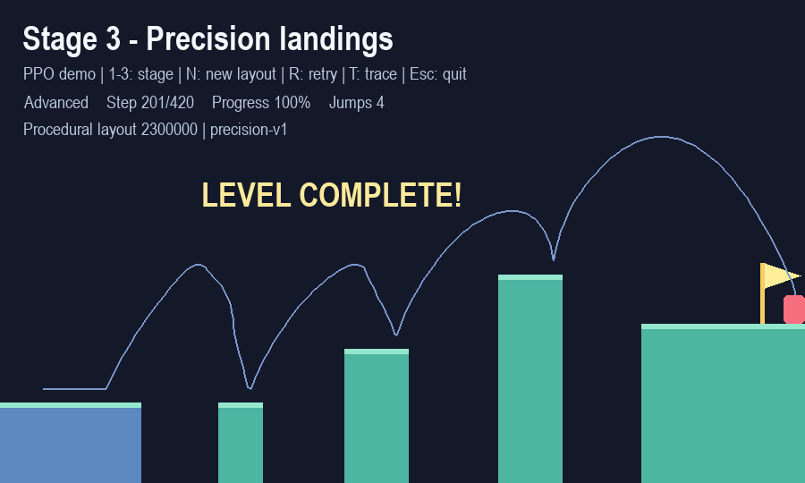
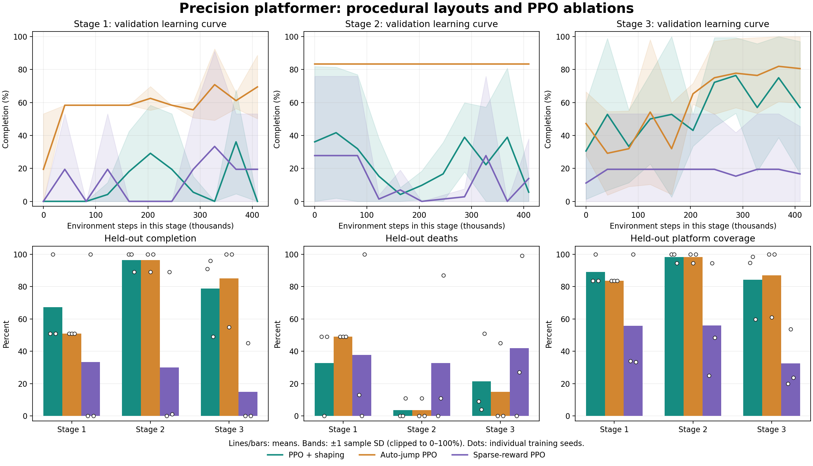

# RL_Platform_Game

使用 **PyGame + NumPy PPO** 實作的 2D 精準平台跳躍遊戲與強化學習實驗。玩家與代理共用相同的重力、慣性、跳躍及碰撞規則，代理透過數值狀態學習移動、起跳與落地控制。

專案包含五個固定難度關卡、三階段隨機關卡，以及 PPO、自動跳躍 PPO、稀疏獎勵 PPO 的對照實驗。已附上訓練模型與實驗紀錄，可直接觀看代理遊玩。



## 快速開始

使用 Python 3.10 以上版本；目前已在 Windows、Python 3.12.4 環境驗證。訓練以 NumPy 實作，不需要 PyTorch 或 GPU。

以下指令都在**專案根目錄，也就是包含 `game.py` 的資料夾**執行。

```powershell
# 安裝遊戲與訓練依賴。
python -m pip install -r requirements.txt

# 觀看 PPO 挑戰隨機關卡，並顯示移動軌跡。
python game.py --agent --procedural --stage 3 --trace
```

想自己操作，可直接執行：

```powershell
python game.py
```

若要繪製實驗圖表，再安裝額外依賴：

```powershell
python -m pip install -r requirements-experiments.txt
```

## 遊玩與模型展示

| 功能 | 指令 |
| --- | --- |
| 手動遊玩固定關卡 | `python game.py --level 1` |
| 觀看固定關卡模型 | `python game.py --agent --level 5` |
| 手動遊玩隨機關卡 | `python game.py --procedural --stage 3` |
| 觀看隨機關卡模型 | `python game.py --agent --procedural --stage 3 --trace` |
| 重播指定隨機地圖 | `python game.py --agent --procedural --stage 3 --layout-seed 2300000` |
| 體驗落地自動跳躍 | `python game.py --procedural --stage 3 --auto-jump` |

固定模式透過 `--level 1`～`--level 5` 選關，預設載入 `models/levelN_policy.json`；隨機模式透過 `--stage 1`～`--stage 3` 選擇地形難度，預設載入 `experiments/easy_pdf/ppo_shaped/policy.json`，同一組權重可遊玩三個階段。

觀看自動跳躍對照模型：

```powershell
python game.py --agent --procedural --stage 3 --model-dir experiments/easy_pdf/ppo_auto_jump --trace
```

程式會依模型的動作數設定自動跳躍規則。也可以用 `--policy <模型路徑>` 指定單一模型。

### 操作方式

| 按鍵 | 功能 |
| --- | --- |
| ←／→ 或 A／D | 左右移動（手動模式） |
| Space、↑ 或 W | 跳躍（手動模式）；按住可在落地後再次起跳 |
| 1～5 | 切換固定關卡 |
| 1～3 | 切換隨機關卡階段 |
| N | 換下一張隨機地圖 |
| R | 從起點重試目前地圖 |
| T | 顯示／隱藏移動軌跡 |
| Esc | 離開遊戲 |

## 關卡設計

### 五個固定關卡

| 關卡 | 難度 | 最窄落點寬度 | 設計重點 |
| --- | --- | ---: | --- |
| 1 | 入門 | 255 px | 寬平台與小間隙，練習移動、起跳 |
| 2 | 簡單 | 150 px | 不同平台高度與中等間隙 |
| 3 | 中等 | 85 px | 連續窄平台與落地控制 |
| 4 | 困難 | 75 px | 長間隙與陡升平台 |
| 5 | 專家 | 44 px | 精準起跳、空中速度與狹窄落點 |

最窄落點不包含起始平台；角色寬 24 px、高 32 px。難度依操作容錯設計，不代表已訓練模型的通關時間一定依序增加。

### 三階段隨機關卡

| 階段 | 地形 | 中繼平台寬度 | 間隙 |
| --- | --- | --- | --- |
| 1 | 寬平台、相同高度 | 235～310 px | 45～80 px |
| 2 | 中等平台、可變高度 | 110～150 px | 60～90 px |
| 3 | 窄平台、較大的高低差 | 45～75 px | 75～105 px |

生成器使用固定 seed，可重現相同地圖，並檢查平台邊界、起終點與單跳距離上限。這些檢查是幾何與必要可達性篩選，不等同於每張地圖的完整通關證明。

## 強化學習方法

- **狀態**：18 維數值觀察，包含位置、速度、落地狀態、終點水平／垂直距離，以及附近平台的邊界、高度與寬度。
- **動作**：不動、左、右、跳、左＋跳、右＋跳。自動跳躍基準只學習三個方向動作，落地即跳起。
- **網路**：18 維輸入 → 64 個 tanh 神經元 → policy 與 value 輸出。
- **演算法**：PPO clipped objective、GAE、entropy bonus、Adam 與梯度裁剪。
- **回合結束**：通關、掉落，或達到 420 步上限；時間上限與真正終止分開處理，GAE 不跨越回合重設。

塑形獎勵為水平位移 × 0.035、每步 −0.01、停滯額外 −0.1、首次落上新平台 +1、中間平台額外 +5、通關 +20、掉落 −5。平台獎勵只發放一次，中間平台沒有復活功能。稀疏獎勵基準只保留通關 +20 與掉落 −5。

新訓練使用 18 維觀察；既有 17 維固定關卡模型會使用前 17 個特徵，原版線性模型也保留載入支援。

## 訓練

### 固定關卡

訓練單一關卡，並播放新模型：

```powershell
python train_ppo.py --level 3 --updates 300 --output-dir experiments/fixed_level3
python game.py --agent --level 3 --model-dir experiments/fixed_level3
```

依序訓練五關，下一關接續上一關的最佳權重：

```powershell
python train_ppo.py --curriculum --updates 160 --output-dir experiments/fixed_curriculum
```

第 5 關可搭配中途平台起點練習落地控制：

```powershell
python train_ppo.py --level 5 --updates 800 --learning-rate 0.0003 --entropy 0.03 --platform-start-prob 0.5 --init-policy experiments/fixed_curriculum/level4_policy.json --output-dir experiments/fixed_curriculum
```

中途平台起點只用於訓練，驗證與測試仍從第一個平台開始。`--init-policy` 載入權重時會重設 optimizer。

預設為 8 個環境，每次更新各收集 256 步、訓練 4 個 epochs。`--updates` 是每關的更新次數；舊參數 `--episodes-per-update` 現為 `--num-envs` 的別名，代表環境數。

省略 `--output-dir` 時，固定關卡訓練會更新 `models/` 內的同名模型與報告。上方範例使用獨立目錄，方便保留原有結果。新版觀察多了終點高度，重新訓練的數字可能與既有模型不同。

### 隨機關卡與對照實驗

執行三種方法、三個訓練 seeds 的完整實驗：

```powershell
python run_experiments.py --output-dir experiments/my_run
```

| 方法 | 動作 | 獎勵 |
| --- | --- | --- |
| `ppo_shaped` | 六動作，學習起跳時機 | 塑形獎勵 |
| `ppo_auto_jump` | 三個方向動作，落地自動跳躍 | 塑形獎勵 |
| `ppo_sparse` | 六動作，學習起跳時機 | 僅通關與掉落 |

預設 seeds 為 42、43、44。每個階段訓練 200 次更新，每組總計 1,228,800 個環境步數；進入後續階段後，25% 回合練習先前階段。三種方法使用相同互動預算與評估地圖。

每階段提供 1,000 個訓練地圖 seeds、24 張驗證地圖及 100 張測試地圖。選模只依驗證集；模型凍結後才測試未見地圖。隨機關卡實驗不使用中途平台起點或示範動作。

想先確認流程，可執行小預算版本：

```powershell
python run_experiments.py --seeds 42 --updates-per-stage 2 --validation-layouts 2 --test-layouts 2 --output-dir experiments/smoke_run
```

實驗目錄已有 `manifest.json` 時，請改用新的輸出目錄。小預算測試只能確認流程，不適合用來比較學習效能。

## 評估、圖表與軌跡匯出

```powershell
# 重測附帶的五個固定關卡模型。
python train_ppo.py --curriculum --evaluate-only --eval-episodes 100

# 重測附帶的九組隨機關卡模型。
python run_experiments.py --evaluate-only

# 重測自己訓練的實驗。
python run_experiments.py --evaluate-only --output-dir experiments/my_run

# 由實驗資料繪製學習曲線與比較圖，需要 matplotlib。
python plot_experiments.py --experiment-dir experiments/my_run

# 無視窗播放，儲存截圖與逐幀軌跡。
python game.py --agent --procedural --stage 3 --layout-seed 2300000 --trace --headless --screenshot artifacts/demo.png --trajectory artifacts/demo_trajectory.json

# 執行回歸測試。
python -m unittest -v
```

`--evaluate-only` 不進行訓練。隨機關卡重測使用原實驗 manifest 的測試清單，並以 `matches_saved_results` 顯示是否與原始結果一致。`--headless` 通關時結束碼為 0，失敗為 1；軌跡 JSON 包含位置、速度、動作、獎勵與落地事件。

## 已記錄的實驗結果

### 隨機關卡：未見地圖測試

以下為三個訓練 seeds 的平均通關率 ± 樣本標準差。每個模型、每個階段測試 100 張相同的未見地圖，共 9 組訓練、2,700 個模型測試回合。

| 方法 | 階段 1 | 階段 2 | 階段 3 |
| --- | ---: | ---: | ---: |
| PPO＋塑形獎勵 | 67.3% ± 28.3% | 96.3% ± 6.4% | 78.7% ± 25.8% |
| 自動跳躍 PPO＋塑形獎勵 | 51.0% ± 0.0% | 96.3% ± 6.4% | 85.0% ± 26.0% |
| PPO＋稀疏獎勵 | 33.3% ± 57.7% | 30.0% ± 51.1% | 15.0% ± 26.0% |

預設展示模型依驗證表現選出，來自 `ppo_shaped` 的 seed 43；其三階段測試結果為 **100/100、100/100、96/100**。這是一個展示模型的結果，完整比較仍以上表的三個 seeds 為準。



在本次預算下，塑形獎勵組的平均通關率高於稀疏獎勵組，但不同 seeds 仍有明顯差異。自動跳躍在窄平台也能表現良好，目前不能宣稱手動控制跳躍一定較好。泛化結果限於此生成器的參數範圍。

### 固定關卡：既有 17 維模型

| 關卡 | PPO 通關 | 隨機策略通關 | PPO 平均步數 |
| --- | ---: | ---: | ---: |
| 1 | 100/100 | 0/100 | 147.29 |
| 2 | 100/100 | 0/100 | 156.93 |
| 3 | 100/100 | 0/100 | 147.41 |
| 4 | 100/100 | 0/100 | 144.93 |
| 5 | 100/100 | 0/100 | 188.18 |

此表為先前固定地圖實驗：起點 X 在 25～50 隨機取樣，使用 greedy 策略與單一訓練 seed。第 5 關包含額外的中途平台練習；這些數字不代表未見地圖的泛化能力。

完整資料與實驗設計：

- [研究設計與實驗紀錄](EXPERIMENTS.md)
- [隨機關卡實驗總表](experiments/easy_pdf/summary.json)
- [固定關卡實驗總表](models/curriculum_results.json)
- [展示模型的選取紀錄](experiments/easy_pdf/selected_policies.json)

## 專案結構

```text
RL_PlatGame/
├── game.py                      # 手動遊玩、模型展示與軌跡匯出
├── platformer.py                # 固定關卡、物理、觀察與獎勵
├── procedural.py                # 隨機地圖生成與資料切分
├── ppo.py                       # NumPy PPO、模型儲存與載入
├── train_ppo.py                 # 固定關卡訓練與評估
├── run_experiments.py           # 隨機關卡與對照實驗
├── plot_experiments.py          # 學習曲線與研究圖表
├── test_platformer.py           # 物理、PPO 與舊模型回歸測試
├── test_procedural.py           # 地圖切分、獎勵與對照模式測試
├── requirements.txt            # PyGame、NumPy
├── requirements-experiments.txt # 額外的 matplotlib 依賴
├── models/                     # 五個固定關卡的模型與報告
├── experiments/
│   ├── easy_pdf/                # 九組研究實驗、模型與比較圖
│   └── initial/                 # 初期第 5 關訓練紀錄
├── artifacts/                  # 截圖、軌跡與重測結果
├── EXPERIMENTS.md               # 詳細研究設計與結果解讀
└── easy.pdf                    # 專案研究提案
```

隨機實驗的 `manifest.json` 保存參數與地圖清單，各組的 `learning_curve.csv` 保存訓練曲線，`test_episodes.csv` 保存逐回合測試結果。專案根目錄的 `level1_policy.json` 與 `level1_results.json` 為原版線性 PPO 的歷史產物，與 `models/` 的五關模型分開保存。

## 常見問題

**找不到 `pygame` 或 `numpy`？**

請用執行遊戲的同一個 Python 安裝依賴：`python -m pip install -r requirements.txt`。

**程式顯示 `policy missing`？**

確認模型檔存在，並核對 `--model-dir` 或 `--policy`。固定關卡預期有 `levelN_policy.json`；隨機關卡展示目錄預期有 `policy.json`。也可依上方訓練指令產生模型。

**重新訓練後，結果與表格不同？**

表格記錄的是已保存的實驗，seed、訓練預算、觀察版本或套件版本變動都可能改變結果。比較實驗時請保留 manifest，並使用相同評估地圖。

**更多參數怎麼查？**

執行 `python game.py --help`、`python train_ppo.py --help` 或 `python run_experiments.py --help`。
