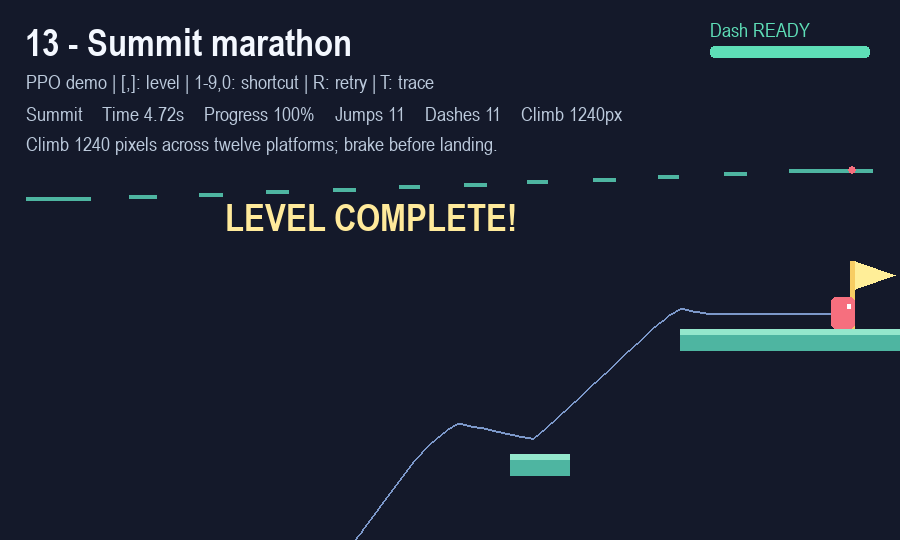

# 衝刺先歸零速度，再沿指定方向加速（agile-v2）

`rl_platformer/envs/movement.py` 的新版衝刺在**成功觸發的那一幀，先將 `vx` 和 `vy` 同時設為 0**，再施加方向加速度。原本的奔跑、上升或下墜動量都會被替換。自觸發幀起最多 8 幀持續加速，空中落地會提前結束；不會每幀重設速度。未取得能量、空中已衝刺過或按住未放開時，無效的衝刺輸入也不會清除速度。

加速度為每幀 2.4 px/frame²，重力仍為 0.48 px/frame²，施加重力前的速度向量上限為 14 px/frame。八方向正規化；未指定方向時沿面向衝刺。若 Space 與衝刺同幀觸發，衝刺會覆蓋當幀的跳躍衝量。落地恢復一格能量，空中只能衝刺一次。

## 操作

- Space：按久跳高、提早放開跳低。
- Shift／X：朝面向衝刺；搭配方向鍵或 WASD 指定八方向。
- A／D 或左右方向鍵：移動與煞車。
- `[`／`]`：切換全部 13 關；R 重試、T 切換軌跡。

畫面同時顯示通關秒數、跳躍次數、**Dashes 衝刺次數**及右上方能量條。時間以 60 FPS 的模擬步數計算。

```powershell
python game.py --level 13
python game.py --agent --level 13 --trace
```

預設模型為 `experiments/state/dash_speedrun/policy.json`。



## 學習方式

直接加大衝刺探索，容易學到頻繁向上衝刺、滯空時間反而變長的策略。因此增加 `rl_platformer/training/bootstrap_dash.py`：只在訓練地圖上嘗試各方向衝刺，以完整模擬確認成功且步數較少，才接受該路線。搜尋出的動作序列用來初始化 actor，再接續 PPO。

搜尋不參與實際遊戲或正式模型評估；播放時只呼叫 PPO 網路。正式 PPO 沒有「按衝刺就加分」的獎勵，仍按位移、首次攀升、每幀時間成本與成功通關計分。選模先達到至少 98% 驗證通關率，再最小化 `mean(成功步數／步數上限；失敗記為 1)`；未達門檻時先提高通關率。衝刺次數只作觀察指標。

`experiments/state/dash_demonstrations_v2/manifest.json` 保存訓練地圖種子、初始模型雜湊、搜尋步數及各路線前後步數；`demonstrations.npz` 保存實際模仿資料。搜尋與模仿的成本獨立於 PPO 步數記錄。

早期限制每回合最多插入三次衝刺的示範存在不一致：前三次之後，即使相似狀態仍適合衝刺，也只示範普通移動。修正版在每個可衝刺狀態重新比較八方向與原策略，完整模擬確認成功且至少節省 5 幀才採納，沒有衝刺次數上限。actor 的隱藏層由 64 擴充至 128；新增神經元的輸出初始為零，擴充當下保持原策略機率。

最終使用 160 個訓練回合、27,128 筆示範狀態，其中 1,317 筆為衝刺動作；搜尋額外執行 9,138,760 個模擬步數，再以 60 epochs 模仿初始化。後續 PPO 使用 seed 42，課程階段 2／3 各 1,600 次更新，每次 8×256 步，合計 **6,553,600 個 PPO 步數**。這些數字不包含舊模型或其他候選實驗的訓練成本。

PPO learning rate 由 0.0002 降至 0.0001、entropy 0.01、gamma 0.995、value coefficient 0.1、target KL 0.02；訓練中間平台起點機率由 20% 降至 0。每幀時間成本為 −0.10，水平淨位移 × 0.015、首次新增攀升 × 0.01，通關 +50 與最多 +20 的時間加分，掉落 −30。驗證與測試都從第一個平台開始。

## 結果與限制

階段 2 選中 update 1440，階段 3 選中 update 1560。最終驗證 **121/123（98.37%）**，成功回合平均 **2.517 秒**，平均 **8.06 次衝刺**。模型凍結後再執行 960 個測試回合；基準模型 `experiments/state/baseline_v1/policy.json` 也使用相同 v2 物理、相同地圖與起點重新測試。

| 測試指標 | 原本較少衝刺的模型 | 新衝刺模型 |
| --- | ---: | ---: |
| 通關數 | 949/960（98.85%） | 920/960（95.83%） |
| 各自成功回合平均時間 | 4.184 秒 | 2.486 秒 |
| 平均衝刺次數（含失敗回合） | 0.056 | **7.892** |
| 共同成功的 913 回合平均時間 | 4.149 秒 | **2.476 秒，快 40.32%** |
| 失敗計入後的正規化時間 | 0.3468 | **0.2323** |

**新模型更快，但測試成功率下降約 3.02 個百分點。** 98% 是驗證選模門檻，不是測試成功率保證。固定 13 關的預設起點全部通過、每關都有使用衝刺且比基準快。例如第 1 關 146→78 幀，第 10 關 495→302 幀，第 13 關 403→283 幀（6.72→4.72 秒、11 次衝刺）。

將同一新模型的衝刺動作禁用後，通關降至 **255/960（26.56%）**；可見已學到的策略會使用衝刺完成路線。這是未重訓的動作禁用實驗，不能代表獨立訓練「無衝刺模型」的最佳表現。

這是單一訓練 seed，仍有 40 回合失敗，也未證明全域最短路線。測試包含 700 張程序生成地圖與 260 個固定關卡起點；固定地圖參與過訓練，程序生成 seed `11100004` 的幾何與本次訓練候選池重複。其餘 699 張與本次訓練候選池及驗證圖不同，舊教師模型更早期的幾何曝光沒有完整稽核。

候選選模紀錄見 [model_selection.json](../experiments/state/dash_speedrun/model_selection.json)，完整配對、禁用衝刺與固定起點比較見 [comparison.json](../experiments/state/dash_speedrun/comparison.json)。未採用的中間候選已移至舊版封存，現用版本與比較基準保留於 `experiments/state/`。

## 重現與檢查

```powershell
# 重新產生訓練示範與 128 單元初始化模型。
python -m rl_platformer.training.bootstrap_dash --output-dir experiments/state/my_dash_demonstrations

# 接續 PPO；預設已包含階段 2／3、每階段 1600 次與 98% 驗證門檻。
python train_movement.py --init-policy experiments/state/my_dash_demonstrations/policy.json --output-dir experiments/state/my_dash_speedrun

# 重測附帶模型：matches_saved_results 應為 true。
python train_movement.py --evaluate-only

# 相同新物理、相同案例的新舊與禁用衝刺比較。
python -m rl_platformer.training.compare_movement --policy experiments/state/dash_speedrun/policy.json --output experiments/state/new_comparison.json

# 無視窗展示，匯出速度、衝刺狀態與通關時間。
python game.py --agent --level 13 --trace --headless --screenshot artifacts/state/new_level13.png --trajectory artifacts/state/new_level13_trajectory.json
python -B -m unittest discover -s tests/state -v
```

每個實驗保存初始化與最終模型、階段 checkpoint、manifest、驗證曲線與逐回合測試 CSV。重訓會重設 optimizer；NumPy 版本變動也可能影響數值結果。

## 版本相容

明確使用舊 `agile-v1` 模型時，遊戲與 `--evaluate-only` 依保存的版本重播原物理，不會把新衝刺行為混入舊報告。v1 比較基準保留於 `experiments/state/baseline_v1/`。固定跳高、無衝刺的舊實驗及其 `--classic`／`--auto-jump` 遊戲入口已停用，歷史資料可從 `archive/` 還原；目前入口專用於跳躍／衝刺 agent。
