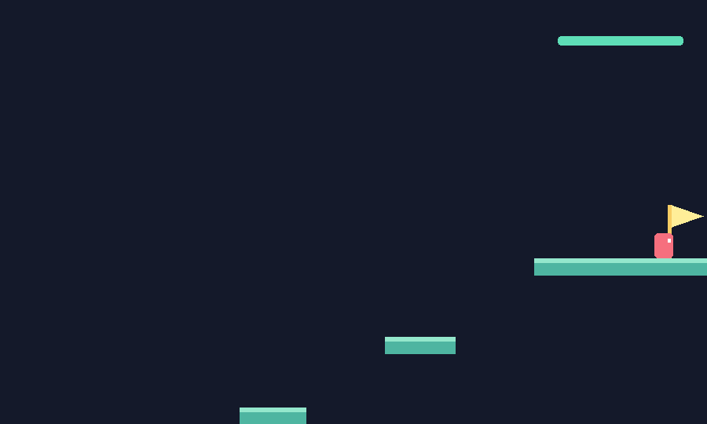

# 畫面辨識 CNN agent

這是獨立於原本狀態 PPO 的 agent。策略只接收遊戲可見視窗的像素：每張縮成 **160 × 96 灰階**，堆疊最近 **4 張**，由三層 CNN、256 維隱藏層與 actor/critic 輸出 24 種按鍵組合。每個遊戲 frame 都決策，保留短跳、長跳、八方向衝刺的細部控制。

`rl_platformer/ui/rendering.py` 與原本 `game.py` 共用角色、平台、鏡頭、旗子及能量條的繪圖。CNN 不接收座標、速度、平台清單、關卡編號、成功率、小地圖或狀態式 action mask。畫面上的訓練文字只畫在預覽視窗外框，不會進入 CNN。這是遊戲內的 framebuffer，不需要讀取桌面，也不受視窗被其他程式遮住影響。

## 開始訓練與觀看

在專案目錄執行；本機已安裝獨立的 PyTorch CUDA 套件，可使用 RTX 4090：

```powershell
# 新一輪訓練，自動建立獨立時間戳記目錄，同時開啟訓練視窗
python -B train_vision.py

# 以每秒 60 個遊戲 frame 的速度觀看，較容易看清楚動作，訓練也會較慢
python -B train_vision.py --realtime

# 完全不使用示範老師，從隨機 CNN 開始做 PPO
python -B train_vision.py --from-scratch --updates 2000

# 從本次 CNN 接續學習；建立新目錄，重新初始化 optimizer
python -B train_vision.py --init-policy experiments/vision/cnn_v1/policy.pt

# 關閉預覽，適合長時間訓練
python -B train_vision.py --no-preview
```

左側是實際正在收集的訓練 episode；右側由上到下是 CNN 收到的四張影像。下方區分示範收集、CNN 權重更新、PPO 自行探索、驗證及最終測試。權重更新期間遊戲暫停，會顯示上一個 rollout 畫面。加速訓練時預覽最多每秒刷新 30 次，可能跳過遊戲 frame，但 agent 每個 frame 都會收到影像。

**Space** 暫停／繼續；**Esc** 或關閉視窗會儲存 `last_policy.pt` 後停止，保留已選出的 `policy.pt`。預設完成指定更新數與比較後，視窗會關閉。

```powershell
# 播放最近一輪已儲存的 CNN（也包含安全中止的訓練）
python -B play_vision.py --level 1

# 指定本次模型；相同關卡可用原本 game.py 比較
python -B play_vision.py --policy experiments/vision/cnn_v1/policy.pt --level 13
python -B game.py --agent --level 13

# 隨機爬高關卡
python -B play_vision.py --family height --stage 2

# 重新評估原本保存的同一批測試案例，不改寫檔案
python -B train_vision.py --evaluate-only experiments/vision/cnn_v1 --no-preview

# 已中止的訓練也可評估；另外保存比較報告，不改寫原 run
python -B train_vision.py --evaluate-only experiments/vision/cnn_v1 --report-dir experiments/vision/my_comparison --no-preview
```

播放時 Space 暫停，Esc 離開；episode 結束會自動重播。`--headless` 只跑一次，成功 exit 0、失敗 exit 1。`--screenshot` 可儲存新的截圖檔，拒絕覆蓋既有檔案。

## 訓練方法與比較範圍

預設先用原本 `experiments/state/dash_speedrun/policy.json` 收集示範，進行 behavior cloning，再用 DAgger 收集學生偏離路線時的修正示範。**只有這個訓練階段的老師能讀取狀態**；學生的輸入始終是像素。接著 PPO 由 CNN 自己選擇動作，沒有老師接管。`--from-scratch` 可關閉整個示範階段，但通常需要更長的探索時間。

獎勵與終止由模擬器提供，與一般影像 RL 相同。使用 agile-v2 物理，衝刺先清除速度再加速；每 frame 時間懲罰 0.10，加上進度、爬高與通關獎勵，並將全部獎勵乘以 0.05 以穩定 critic。GAE 的 timeout 使用最後一張畫面估值，死亡／成功不 bootstrap，episode 間不串接 advantage。

模型只依驗證集選擇：先比較通關率，同通關率時比較將失敗計入的正規化耗時。最終測試使用固定案例，讓 CNN 與原本 agent 面對**相同關卡、起點、物理及時間限制**。同時保存雙方成功案例的配對時間，避免拿不同難度的成功子集直接比較速度。

固定 13 關也會用於訓練，不能稱為未見關卡泛化。生成關卡的 train／validation／test 使用不同 seed 範圍，但不同 seed 仍可能產生相同幾何，`manifest.json` 保存碰撞稽核。繼承的老師先前接觸過哪些幾何未完整稽核。

這一版使用短期影像記憶，對窄平台、遠距離路線與長時間遮擋仍可能不如直接取得狀態的 agent；結果應以保存的通關率及配對時間判讀。

## 第一版已實測結果

模型：[cnn_v1/policy.pt](../experiments/vision/cnn_v1/policy.pt)。同批 109 個案例的完整報告：[cnn_v1_evaluation/results.json](../experiments/vision/cnn_v1_evaluation/results.json)。

| 指標 | 畫面 CNN | 原狀態 PPO |
| --- | ---: | ---: |
| 通關 | 74 / 109（67.89%） | 106 / 109（97.25%） |
| 雙方皆成功的 74 局平均耗時 | 2.502 秒 | 2.475 秒 |
| 全部案例平均衝刺次數 | 6.56 | 8.00 |

本次完成 47,021 張示範收集（buffer 保留 24,000 張）、20 個 BC epoch、兩輪各 10 epoch 的 DAgger，以及 50 次 PPO 更新／51,200 個 PPO 環境步驟。視窗收到關閉事件後安全停止，原定 80 次更新沒有全部跑完。保存的最佳模型來自 `DAgger-1-5`，驗證成功 21 / 27；這次短期 PPO 更新尚未超過該模型，所以播放保留較好的版本。

第 11 關預設起點實測 2.45 秒、8 次衝刺通關；第 13 關預設起點仍會失敗。生成關卡 full stage 3 為 0 / 10、stage 4 為 1 / 10，顯示窄平台與長路線仍是明顯弱點。這是第一版視覺基準，尚未達到原 agent 的穩定度。



## 後續完成版本

另有完整訓練紀錄保留於 `experiments/vision/20261020_134343_080697/`，沒有覆蓋第一版。已保存結果為 **81 / 109（74.31%）**，同批狀態 agent 為 **106 / 109（97.25%）**；共同成功 80 局，CNN 平均 2.467 秒、狀態 agent 2.440 秒。`play_vision.py` 未指定 `--policy` 時會選擇最近儲存的版本。

完整資料：[後續版本結果](../experiments/vision/20261020_134343_080697/results.json)。

## 獨立輸出

預設輸出到 `experiments/vision/YYYYMMDD_HHMMSS_microseconds/`。指定 `--output-dir` 時，目錄必須不存在；程式拒絕覆蓋任何既有 run。現用 `experiments/state/dash_speedrun/` 與 `game.py --agent` 的預設模型保留。

| 檔案 | 內容 |
| --- | --- |
| `manifest.json` | 參數、案例、輸入規格、老師 hash、套件版本與幾何稽核 |
| `initial_policy.pt` | 初始 CNN |
| `policy.pt` | 驗證選出的最佳 CNN，播放預設使用這個 |
| `last_policy.pt` | 最新更新的 CNN，可能不如最佳模型 |
| `learning_curve.csv` | 每次驗證的通關率、耗時與衝刺次數 |
| `demonstrations.json` | 示範數量與老師來源；不保存龐大像素 buffer |
| `results.json` | 最終 CNN／原 agent 比較、分組結果與原模型 hash 檢查 |
| `vision_episodes.csv`／`state_baseline_episodes.csv` | 同批案例的逐局結果 |
| `status.json` | training／complete／interrupted |
| `training_preview.png` | 保存的預覽畫面，畫面下方標示實際階段 |

## 其他電腦安裝與測試

原本 NumPy agent 不需要 PyTorch。可在獨立虛擬環境安裝 `requirements/vision.txt`；Windows NVIDIA GPU 的本機目錄安裝方式如下，使用 [PyTorch 官方 CUDA wheel](https://pytorch.org/get-started/previous-versions/)：

```powershell
python -m pip install --target .vision_deps torch==2.11.0 --index-url https://download.pytorch.org/whl/cu128
python -m pip install --target .vision_deps numpy==2.2.6 "pygame>=2.6,<3"
```

無 NVIDIA GPU 時，第一行的 index 改為 `https://download.pytorch.org/whl/cpu`，執行時可加 `--device cpu`。本專案會優先載入 `.vision_deps`，該目錄已加入 `.gitignore`。本機使用獨立 OpenBLAS NumPy，避免原 Anaconda MKL 與 PyTorch 的 OpenMP 衝突；舊版 Anaconda 的 C++ runtime 衝突以程序內預載系統 DLL 處理，不修改系統 PATH 或原套件。

```powershell
# 原本測試保持不依賴 PyTorch
python -B -m unittest discover -s tests/state -v

# 視覺 agent 的獨立測試程序
python -B -m unittest discover -s tests/vision -v
```
